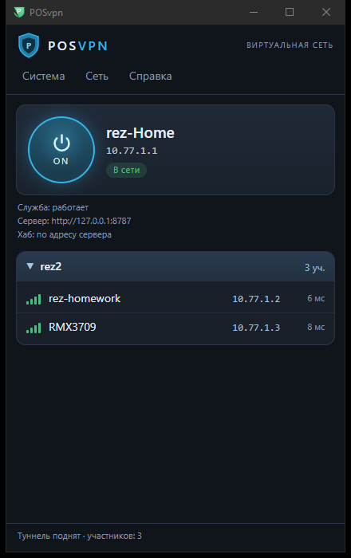
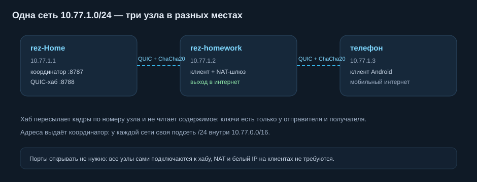
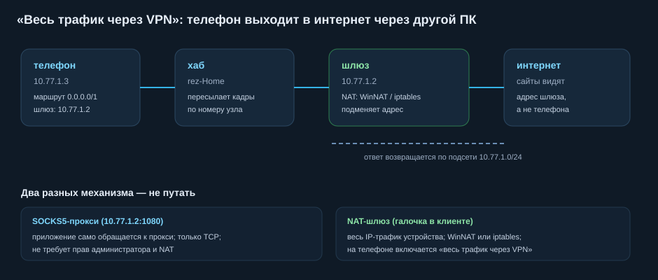

# POSvpn

Виртуальная локальная сеть через интернет: свои компьютеры, телефоны и удалённые
офисы в одном `10.77.0.0/16`, без аккаунта и без настройки роутера на рабочих местах. Вместо чужого
сервера — ваш собственный: координатор и QUIC-хаб в одном бинарнике.

`0.9.3` · Windows 10/11 x64 · Android 8.0+ · Go 1.27



---

## Что это

- **Своя сеть на 25 узлов.** Имя сети и пароль — всё, что нужно для входа.
  Адреса выдаёт координатор: у каждой сети своя подсеть `/24` внутри `10.77/16`.
- **Прямой L3-туннель.** Виртуальный адаптер Wintun, MTU 1100, шифрование
  X25519 + HKDF + ChaCha20-Poly1305. Хаб пересылает кадры по номеру узла и не
  читает содержимое.
- **Ноль настройки на рабочих местах.** Все узлы сами подключаются к хабу по QUIC:
  NAT, белый IP и проброс портов на клиентах не нужны. Серверу нужен либо публичный адрес (VPS), либо проброс на роутере: TCP 8787 (координатор) и UDP 8788 (хаб).

<p>

</p>

## Что умеет

| Возможность | Как это выглядит |
|---|---|
| **Вход в сеть** | Имя сети и пароль, без регистрации и профиля |
| **Список узлов** | Имя, адрес `10.77.x.y`, статус онлайн, задержка в миллисекундах |
| **Своя инфраструктура** | Координатор и хаб на вашем VPS или домашнем ПК, состояние — JSON-файл |
| **Служба Windows** | Туннель живёт без окна, поднимается вместе с системой, окно — только для настроек |
| **Прокси SOCKS5** | Узел с интернетом отдаёт его участникам: браузер, Telegram, git, CLI-агент |
| **NAT-шлюз** | Галочка «Раздавать интернет всей сети»: телефон выходит в интернет через ваш ПК |
| **Android-клиент** | Та же сеть с телефона: `ping`, SMB, веб-интерфейсы, «весь трафик через VPN» |

## Кому подходит

Малым распределённым организациям: точек много, они в разных местах, а учётная база одна.

| Сценарий | Что даёт POSvpn |
|---|---|
| **Сеть магазинов у дома** (5–25 точек) | Кассы и товароучёт на 1С подключаются к серверу в офисе как в локальной сети. Белый IP и настройка роутера на каждой точке не нужны |
| **Мобильная торговля** | Ноутбук агента из гостиницы или сотовой сети входит в ту же сеть и работает с 1С, файлами и принтерами офиса |
| **Доставка и склад** | Диспетчер, курьеры и кладовщик в одной сети: накладные, терминалы сбора данных, IP-камеры |
| **Удалённый бухгалтер или подрядчик** | Доступ к 1С и файловым папкам без публикации базы в интернет; доступ отзывается одной кнопкой |

**Почему это работает с 1С.** Сеть выдаёт настоящий адрес `10.77.x.y`, поэтому клиент
1С обращается к серверу, например `10.77.1.10:1541`, так же, как в офисе, а файловая
база открывается по `\\10.77.1.10\share`. Прокси SOCKS5 нужен только приложениям,
которые сами умеют прокси, и только для TCP.

**Что учесть заранее.** До 25 узлов в одной сети; сеть L3 без ARP, поэтому имена
Windows могут не находиться автоматически — подключайтесь по адресу; канал у всех
общий, и файловая 1С на большом объёме будет медленнее, чем в офисе.
## Быстрый старт

1. **Сервер.** Запустите `posvpn-server.exe` на машине с публичным адресом (VPS
   или домашний ПК). Координатор слушает `:8787`, хаб — `:8788`; для HTTPS
   укажите `-tls-cert` и `-tls-key`.
2. **Первый компьютер.** Установите клиент, откройте окно → «Создать сеть»:
   имя, пароль от 8 символов, имя устройства. Адрес координатора — ваш сервер.
3. **Остальные.** «Присоединиться к сети» с тем же именем и паролем. Узлы
   появляются в списке с адресами и задержкой.
4. **Проверка.** `ping 10.77.1.2` с любого узла — и можно открывать SMB-папки,
   веб-интерфейсы и базы на удалённой машине.
5. **Телефон.** APK из [Releases](https://github.com/reznikov73/POSvpn/releases),
   те же имя сети и пароль. Пароль запоминается — вводить его каждый раз не нужно.

## Интернет через другой узел: два способа

<p>

</p>

- **SOCKS5-прокси** — для отдельных приложений. На узле с интернетом включите
  «Выход в интернет через этот узел», остальные вписывают `10.77.x.1:1080` в
  браузер, Telegram или git. Только TCP, права администратора не нужны.
- **NAT-шлюз** — для всего устройства. На узле включите «Раздавать интернет всей
  сети», на телефоне — «Весь трафик через VPN» и адрес шлюза. Нужен WinNAT
  (Windows Pro/Enterprise) или `iptables` на Linux.

Подробные инструкции: [docs/09-прокси-инструкция.md](docs/09-прокси-инструкция.md)
и [docs/10-эксплуатация.md](docs/10-эксплуатация.md).

## Чем отличается от Radmin VPN

| | Radmin VPN | POSvpn |
|---|---|---|
| Сервер | чужой | ваш VPS или домашний ПК |
| Аккаунт | профиль в приложении | не нужен: имя сети и пароль |
| Уровень сети | L2 Ethernet, свой NDIS-драйвер | L3 (Wintun), подписанный драйвер |
| Узлов в сети | 150 | 25 |
| Прокси / NAT | нет | SOCKS5 и NAT-шлюз |
| API | нет | HTTP/JSON |
| Цена | бесплатно | бесплатно + ваш сервер |

Полное сравнение — [docs/08-сравнение-с-Radmin.md](docs/08-сравнение-с-Radmin.md).

## Компоненты

| Компонент | Каталог | Что внутри |
|---|---|---|
| Сервер | [posvpn-server/](posvpn-server/) | координатор сетей, хранилище, QUIC-хаб |
| Клиент Windows | [posvpn-client/](posvpn-client/) | туннель, служба, окно, трей, прокси, NAT |
| Клиент Android | [android/](android/) | VpnService, Go-ядро через gomobile, окно на Java |
| Движок | [engine/](engine/) | типы, адресация, ключи, кадр, SOCKS5, wintun |

## Документация

| Файл | О чём |
|---|---|
| [docs/01-аналоги.md](docs/01-аналоги.md) | обзор рынка и аналогов |
| [docs/03-архитектура.md](docs/03-архитектура.md) | L3, QUIC, свой кадр, адресация, безопасность |
| [docs/05-план.md](docs/05-план.md) | этапы и что дальше |
| [docs/06-ТЗ.md](docs/06-ТЗ.md) | требования и их статус |
| [docs/09-прокси-инструкция.md](docs/09-прокси-инструкция.md) | прокси: шлюз и клиенты, пошагово |
| [docs/10-эксплуатация.md](docs/10-эксплуатация.md) | служба, трей, HTTPS, журналы, счётчики |

## Сборка из исходников

```powershell
.\build.ps1          # out\posvpn-server.exe и out\posvpn-client.exe
.\release.ps1 "область: результат"   # exe + установщик + коммит + пуш
```

Требования: Go 1.27+, Inno Setup 6 для установщика. Android собирается
отдельно: [android/README.md](android/README.md).

### VS Code: задачи и отладка

В репозитории уже лежат `.vscode/tasks.json` и `.vscode/launch.json`:

| Задача (Ctrl+Shift+B) | Что делает |
|---|---|
| `build: all` | оба exe (по умолчанию) |
| `build: server` | только `out\posvpn-server.exe` |
| `build: client` | только `out\posvpn-client.exe` |
| `build: apk` | APK через `android\build-apk.ps1` |

Тесты: `test: engine`, `test: server`, `test: client`. Отладка (F5): сервер
(окно или консоль), клиент (окно, статус, туннель). Для `build: apk` один раз
задайте `ANDROID_HOME`, `JAVA_HOME` и `ANDROID_NDK_HOME`.

## Статус

`0.9.3` — рабочий туннель, окно и служба Windows, трей, установщик с HTTPS и
проверкой отпечатка, SOCKS5-прокси, NAT-шлюз, клиент Android `0.9.7`.
Версия и номер сборки видны в «О программе» каждого компонента.

Дальше по плану: прямой P2P между узлами с релеем как резервом, IPv6, чат,
автообновление. До версии 1.0 формат кадра и API могут меняться.

---

Проект вырос из практической задачи «сделать свою замену Radmin VPN» и
развивается вместе с POSCloud. Вопросы и баги — в issues репозитория.
