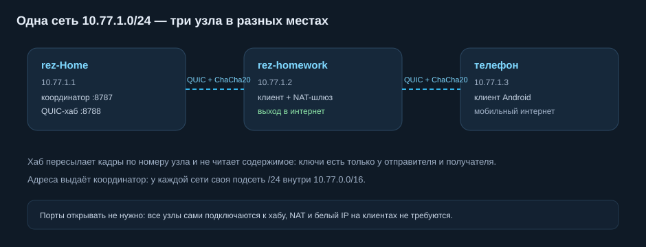
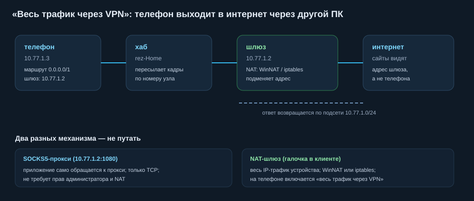

# POSvpn для Android

Телефон в вашей виртуальной локальной сети `10.77.x.y`: те же сети, адреса и шифрование ChaCha20-Poly1305, что у настольного клиента, без аккаунта и проброса портов.

`0.9.7` · Android 8.0+ (API 26) · arm64, armv7, x86_64

<p>

</p>

*Схема: телефон `10.77.1.3` сам подключается к вашему серверу по QUIC и становится равноправным участником сети — как ПК `10.77.1.1` и `10.77.1.2`.*

## Что умеет

| Возможность | Как это выглядит |
|---|---|
| **Вход по имени сети и паролю** | Регистрации нет: имя сети, пароль от 8 символов, имя устройства |
| **Свой адрес `10.77.x.y`** | Выдаёт координатор; у каждой сети своя подсеть `/24` внутри `10.77.0.0/16` |
| **Участники сети** | Имя, адрес, точка онлайн, задержка в миллисекундах; администраторы помечены |
| **Split-tunnel по умолчанию** | В туннель уходит только `10.77.0.0/16`, интернет телефона идёт напрямую |
| **«Весь трафик через VPN»** | Переключатель: маршрут по умолчанию на шлюз сети (на шлюзе нужен NAT) |
| **Тёмное оформление** | Тёмный фон и зелёный акцент; светлой темы нет |

## Установка

1. Скачайте APK из [Releases](https://github.com/reznikov73/POSvpn/releases) — файл `POSvpn-0.9.7.apk`.
2. Откройте файл и разрешите установку из этого источника, если Android спросит.
3. Откройте приложение → «⋮» → «Настройки»: сервер, при `https` ещё отпечаток, имя сети, пароль, имя устройства.
4. Нажмите «Войти в сеть» (или «Создать сеть», если вы первый) — приложение вернётся на главный экран.
5. Нажмите «Подключить» и подтвердите запрос системы на VPN — статус сменится на **«Подключено»**.

Проверка: `ping 10.77.x.y` с любого узла сети до телефона.

## Экран приложения

Скриншотов пока нет — вот что на экране и что с этим делать:

- **Карточка состояния** — статус («Подключение…» / «Подключено» / «Ошибка»), имя сети, ваш адрес, имя устройства и адрес хаба.
- **Кнопка «Подключить» / «Отключить»** — одна на всё; при первом нажатии система спрашивает разрешение на VPN.
- **«Участники сети»** — список узлов с адресами и задержкой, обновляется раз в секунду; пустой список подсказывает, что вы пока один.
- **Меню «⋮»** — «Настройки», «Выйти из сети», «О программе».
- **Уведомление «POSvpn активен»** — туннель живёт в foreground-службе с постоянным уведомлением, этого требует Android.

Схема режима «весь трафик через VPN»:

<p>

</p>

*Телефон → хаб → ПК-шлюз `10.77.1.2` → интернет: сайты видят адрес шлюза, а не телефона. Внизу схемы — чем это отличается от SOCKS5-прокси.*

## Настройки: что означают поля

| Поле | Что вписать |
|---|---|
| **Сервер (координатор)** | `https://vpn.example.ru:8787` — адрес, доступный с телефона. Пусто — `http://127.0.0.1:8787`, это годится только для отладки на самом сервере |
| **Хаб** | `vpn.example.ru:8788`. Пусто — выводится из адреса сервера: тот же хост, порт 8788 |
| **Отпечаток сертификата** | hex-строка. Нужен для `https`: по нему проверяются и API координатора, и QUIC-хаб. Без отпечатка HTTPS-соединение не проверяется — так можно только для отладки |
| **Имя сети** | `office` — то же, что у остальных участников; регистр не важен |
| **Пароль сети** | От 8 символов. Запоминается в приватном каталоге приложения (0600, без резервных копий) — при следующем входе вводить не нужно; стирается при «Выйти из сети» |
| **Имя этого устройства** | Как узел зовут в списке. По умолчанию — модель телефона, вычищенная до букв, цифр, `-` и `_` |
| **Шлюз в интернет** | `10.77.x.y` — участник, через который телефон выходит в интернет. Пусто — пакеты вне подсети отбрасываются |
| **«Весь трафик через VPN»** | Переключатель режима; сохраняется сразу, поднятый туннель пересобирается |

Кнопки: «Создать сеть» и «Войти в сеть» — вход и сохранение всего сразу; «Сохранить настройки» — только сервер, хаб, отпечаток и шлюз, без входа в сеть.

## «Весь трафик через VPN»: условия и ограничения

Что делает: добавляет маршруты `0.0.0.0/1` и `128.0.0.0/1` (два `/1` вместо `0.0.0.0/0`, который `VpnService.Builder` не принимает) и DNS `8.8.8.8` / `1.1.1.1`. Пакеты вне подсети уходят узлу из поля «Шлюз».

1. Шлюз есть в сети, и в поле «Шлюз» указан его адрес.
2. На шлюзе настроен NAT для `10.77.0.0/16`:
   - Windows Pro/Enterprise — WinNAT (компонент Hyper-V) и права администратора; настольный клиент поднимает его галочкой «Раздавать интернет всей сети»;
   - Linux — `net.ipv4.ip_forward=1` и `iptables -t nat … MASQUERADE`;
   - Windows Home — WinNAT нет, режим не заработает.
3. ICS («Общий доступ к подключению к Интернету») не подходит: он навязывает внутреннему интерфейсу `192.168.137.1`.

Ограничения:

- Это L3-путь, а не прокси: SOCKS5 в Android-клиенте нет вообще, а прокси на шлюзе в этом режиме не участвует — записей «прокси:» в журнале не будет.
- Прокси — другой механизм: приложение само обращается к `10.77.x.y:1080`, только TCP (`CONNECT`), без UDP и BIND.
- Трафик идёт телефон → хаб → шлюз → интернет: задержка и расход батареи выше, чем при split-tunnel.

## Сборка из исходников

| Что | Версия |
|---|---|
| Go | 1.27+ (в `android/go/go.mod` — 1.27.1) |
| JDK | 21 (скриптам достаточно 17+) |
| Android SDK | platform-33, build-tools 35 |
| Android NDK | r27 |
| gomobile | `go install golang.org/x/mobile/cmd/gomobile@latest` |

```bash
SDK=$HOME/android-sdk JDK=$HOME/jdk ANDROID_NDK_HOME=$SDK/android-ndk-r27c ./android/build-apk.sh
# → android/android/out/POSvpn-0.9.7.apk
```

Два шага, каждый можно запускать отдельно:

1. `android/build-apk.sh` → `gomobile bind` собирает `android/libs/posvpn.aar` (Go-ядро и JNI) для arm64, armv7 и x86_64.
2. `android/android/build.sh` → `aapt2`, `javac`, `d8`, `zipalign`, `apksigner` собирают APK. Gradle не используется.

Версия `0.9.7` и номер сборки `7` заданы в `android/android/build.sh` и переопределяются переменными `VERSION_NAME` и `VERSION_CODE`. Подпись — `android/android/keystore.jks`: создаётся при первой сборке, поэтому новая версия ставится поверх старой.

Движок подключается по пути `../../engine` (`replace posvpn-engine => ../../engine` в `android/go/go.mod`), так что собирать нужно из клона этого репозитория. Тесты Go-части идут без Android: `cd android/go && go test ./...`.

## Совместимость

| Компонент | Версия |
|---|---|
| Протокол кадров | 1 |
| Сервер POSvpn | 0.9.x; сервер обязан выдавать числовой индекс узла |
| API координатора | `/api/v1` |
| Android | minSdk 26 (8.0), targetSdk 33 |
| ABI | arm64-v8a, armeabi-v7a, x86_64 |
| MTU туннеля | 1100 |

До версии 1.0 формат кадра и API могут меняться — закрепляйте версию движка на проверенном коммите.

## Версия и сборка

«⋮» → «О программе»: версия и номер сборки берутся из установленного пакета, рядом — напоминание, что клиент совместим с настольным POSvpn 0.9.x. Скрипт сборки по умолчанию ставит версию `0.9.7` и номер сборки `7`.

## Ограничения

- **IPv6 нет.** В TUN назначается только IPv4-адрес и маршрут `10.77.0.0/16`; IPv6-трафик телефона идёт мимо туннеля.
- **UDP через прокси нет.** SOCKS5 в проекте — только TCP (`CONNECT`), поэтому игры и другие UDP-приложения через прокси не пойдут. В Android-клиенте прокси нет вовсе: только маршрутизация IP-пакетов.
- **Windows Home без NAT.** WinNAT входит в Hyper-V, на Home его нет: «весь трафик через VPN» там не заработает, остаётся split-tunnel.
- **L2 нет.** Сеть — L3: ARP и Ethernet-кадры не поддерживаются, широковещательные IP-пакеты работают, Ethernet-бродкаст — нет.
- **Один хаб.** Скорость ограничена каналом сервера, задержка — маршрутом до него; при обрыве туннель переподключается с паузой от 1 до 30 с.

---

Подробности: [../docs/03-архитектура.md](../docs/03-архитектура.md), [../docs/10-эксплуатация.md](../docs/10-эксплуатация.md).
