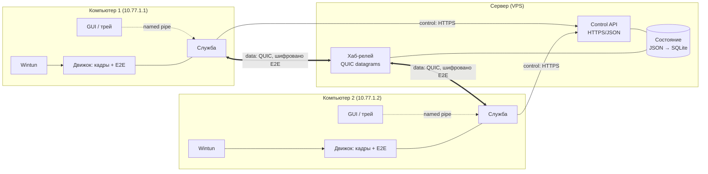
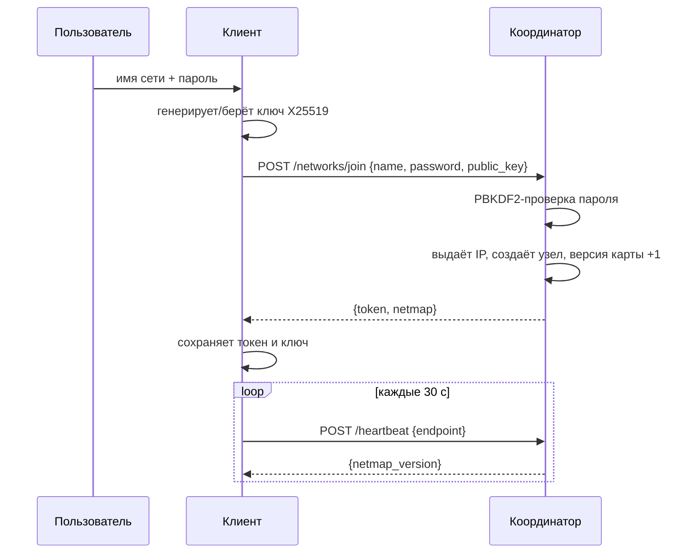

# Архитектура POSvpn

## 1. Общая схема



Три плоскости, как у NetBird, но в одном бинарнике сервера:

| Плоскость | Что делает | Где живёт |
|---|---|---|
| Management | реестр сетей, участников, ролей, выдача адресов, карта сети | `posvpn-server`, HTTP API |
| Signal | обмен внешними адресами и кандидатами для P2P | тот же API, этап 4 |
| Data | перенос зашифрованных IP-пакетов | QUIC-хаб, этап 1 |

## 2. Компоненты

### `posvpn-server` — координатор

- Хранит сети, узлы, роли, хеши паролей и токенов.
- Выдаёт адрес из подсети сети, числовой индекс узла и собирает карту сети (netmap).
- Принимает heartbeat с внешним адресом узла.
- Поднимает QUIC-хаб (`-hub`, по умолчанию `0.0.0.0:8788`): проверяет токен
  узла, пересылает кадры по индексу, подменяет `src` на настоящий индекс,
  размножает `dst = 0` по сети. Содержимое кадров не читает.

Состояние — один JSON-файл с атомарной записью (временный файл + `rename`).
Для 10–100 узлов этого достаточно; при росте меняется на SQLite без изменения
API.

### `posvpn-client` — клиент

Сейчас CLI. Целевая форма — два процесса:

| Процесс | Права | Ответственность |
|---|---|---|
| Служба `posvpn-service` | SYSTEM | Wintun, маршруты, DNS, туннель, автозапуск |
| GUI `posvpn-client` | пользователь | трей, окно, список участников, вход в сеть |

Причина разделения: служба живёт в сессии 0 и не может показывать UI, а
создание адаптера требует прав администратора. Общение — именованный пайп,
протокол — те же JSON-сообщения.

Пока службы нет, окно работает в одном процессе и запускается от
администратора: интерфейс — встроенный HTML в WebView2, мост в Go через
`Bind`. Тот же бинарник без аргументов открывает окно, с командой `wizard` —
консольный мастер, с `create`/`join`/`up` — обычный CLI.

### `engine` — общий модуль

Типы протокола, карта сети, адресация, пароли, токены, ключи. Всё, что должно
одинаково пониматься клиентом и сервером.

## 3. Модель данных

| Сущность | Поля | Где хранится |
|---|---|---|
| Network | ID, имя, подсеть, хеш пароля, закрыта, создана | сервер |
| Node | ID, сеть, имя, публичный ключ, IP, роль, хеш токена, endpoint, last_seen, blocked | сервер |
| NetMap | сеть, подсеть, версия, self, список пиров | выдаётся клиенту |
| Peer | ID, имя, IP, публичный ключ, роль, endpoint, online | внутри NetMap |
| ClientConfig | сервер, токен, сеть, IP, пара ключей | `%AppData%\POSvpn\client.json` |

Связи: сеть 1—N узлов; узел принадлежит ровно одной сети; карта сети — проекция
узлов для конкретного клиента.

**Инварианты:** имя сети уникально без учёта регистра; имя узла уникально
внутри сети; последний администратор не может уйти; адрес не переиспользуется,
пока узел в сети.

## 4. API

База: `https://<сервер>/api/v1`. Тело и ответы — JSON. Аутентификация —
`Authorization: Bearer <токен узла>`.

| Метод | Путь | Тело | Ответ |
|---|---|---|---|
| POST | `/networks` | `{name, password, node_name, public_key}` | 201 `{node_id, token, netmap}` |
| POST | `/networks/join` | `{name, password, node_name, public_key}` | 200 `{node_id, token, netmap}` |
| GET | `/netmap` | — | 200 `NetMap` |
| POST | `/heartbeat` | `{endpoint}` | 200 `{netmap_version}` |
| POST | `/leave` | — | 204 |
| GET | `/health` | — | 200 `{status:"ok"}` |

Коды ошибок: 400 — некорректный запрос, 401 — неверный пароль или токен,
403 — сеть закрыта или узел заблокирован, 404 — нет сети/узла, 409 — конфликт
имени или лимит участников.

Пример карты сети:

```json
{
  "network_id": "n_1adc48acd280678a",
  "network_name": "office",
  "subnet": "10.77.1.0/24",
  "version": 2,
  "self": {
    "node_id": "u_9f3c...", "name": "PC-2", "ip": "10.77.1.2",
    "public_key": "base64...", "role": "user", "online": true
  },
  "peers": [
    {
      "node_id": "u_41ab...", "name": "PC-1", "ip": "10.77.1.1",
      "public_key": "base64...", "role": "admin",
      "endpoint": "203.0.113.5:51820", "online": true
    }
  ]
}
```

`version` растёт при каждом изменении состава сети. Клиент сравнивает версию
из heartbeat и перезапрашивает карту только когда она изменилась.

## 5. Поток входа



## 6. Плоскость данных (этап 1)

### Кадр

```
+---------+--------+--------+--------+-------+----------+-------------------+
| version | type   | dst    | src    | epoch | counter  | ciphertext+tag    |
| 1 байт  | 1 байт | 4 байта| 4 байта| 4 байта| 8 байт  | N байт            |
+---------+--------+--------+--------+-------+----------+-------------------+
```

- `type`: 1 — IPv4-пакет, 2 — IPv6, 3 — ping, 4 — pong.
- `dst`/`src`: числовой индекс узла в сети, который выдаёт сервер (строковые
  ID остаются в API). `dst = 0` — всем участникам.
- `epoch`: случайный номер запуска узла. Вместе с `counter` образует nonce,
  поэтому после перезапуска счётчик снова начинается с единицы без риска
  повтора nonce и без ложного срабатывания защиты от повтора у пира.
- `counter`: монотонный счётчик, отдельный на каждое направление пары.
- `ciphertext`: IP-пакет, зашифрованный ChaCha20-Poly1305 ключом направления.

Заголовок открыт: хабу нужно знать, кому переслать кадр. Содержимое хаб не
читает. Заголовок входит в дополнительные данные AEAD, поэтому подмена
`dst`, `src`, `type` или `counter` ломает проверку тега. Исключение — `src`:
хаб всегда ставит туда индекс аутентифицированного отправителя.

Размер заголовка — 22 байта. Максимальный кадр — 1180 байт (одна
QUIC-дейтаграмма), максимальный IP-пакет — 1142 байта.

### Ключи

```
shared = X25519(my_private, peer_public)

k1 = HKDF-SHA256(shared, salt = network_id, info = "posvpn v1 pair key 1", 32)
k2 = HKDF-SHA256(shared, salt = network_id, info = "posvpn v1 pair key 2", 32)

узел с меньшим индексом:  отправка k1, приём k2
узел с большим индексом:  отправка k2, приём k1
```

Два ключа нужны потому, что счётчики направлений независимые. С одним ключом
обе стороны выдали бы одинаковые nonce (epoch и counter совпадают) — для
ChaCha20-Poly1305 это катастрофа. Направление выбирается по индексам, поэтому
обе стороны выводят одинаковую пару без дополнительного обмена.

Приватный ключ не покидает узел. Публичные ключи приходят в карте сети.
Следствие: хаб видит только метаданные (кто, когда, сколько), но не трафик.

### Бродкаст

Пакет на `255.255.255.255`, широковещательный адрес подсети или multicast
шифруется **отдельно для каждого пира** и отправляется кадром с `dst = индекс
пира`: у каждого участника свой ключ, один общий кадр расшифровать нельзя.
`dst = 0` хаб тоже поддерживает — он размножает кадр по всем участникам сети,
но это годится только для служебных кадров без шифрования.

ARP и Ethernet-кадры при этом **не поддерживаются**: Wintun их не отдаёт.

### MTU

`1100` байт на Wintun. Причина: кадр должен помещаться в одну QUIC-дейтаграмму,
а QUIC гарантирует только 1200 байт. Из них 22 байта заголовка и 16 байт тега
оставляют 1162 байта на IP-пакет; 1100 — запас на служебные поля и PMTU.

Отказ от 1280 осознанный: фрагментация в userspace выглядит как «ping
работает, а файлы нет». Лучше потерять 180 байт MTU, чем отлаживать чёрные
дыры. Если понадобится 1280 — это отдельная задача с фрагментацией и
пересборкой пакетов.

### Почему не WireGuard в MVP

WireGuard — это карта «префикс → один пир»: один и тот же пакет нельзя
разослать нескольким получателям. Бродкаст, ради которого и делают «локалку»,
на нём не строится. Плюс в модели WireGuard нет понятия «хаб пересылает
чужой трафик»: это делает либо ядро ОС, либо отдельный релей.

Когда понадобится P2P, WireGuard можно вернуть как транспорт для прямых
каналов — но не как основу адресации.

## 7. NAT traversal

### MVP: хаб

Весь трафик идёт через сервер. Это не «настоящий P2P», зато:

- работает всегда, включая симметричный NAT и CGNAT;
- один код-путь, проще отладка;
- задержка +RTT сервера, пропускная способность ограничена каналом VPS.

Для 2–10 узлов и типичных задач (RDP, файлы, 1С) этого достаточно.

### Этап 4: прямые каналы

1. Клиент узнаёт свой внешний адрес через STUN (`pion/stun`) и сообщает его
   в heartbeat.
2. Сервер раздаёт кандидатов (host, srflx, relay) в карте сети.
3. `pion/ice` проводит проверки связности — это и есть hole punching.
4. Если прямой канал встал за 5 секунд, кадры идут напрямую; иначе остаются
   на хабе. Попытки прямого соединения не прекращаются.
5. Keepalive каждые 25 секунд; при смене сети — ICE restart.

Правило: **релей никогда не выключается**, он просто перестаёт быть основным.

## 8. Безопасность

| Что защищаем | Чем |
|---|---|
| Пароль сети | PBKDF2-HMAC-SHA256, 600 000 итераций, случайная соль; на сервере только хеш |
| Токен узла | 32 случайных байта; на сервере только SHA-256 |
| Канал клиент ↔ сервер | TLS 1.3 (HTTP/2 или HTTP/1.1), потом QUIC |
| Трафик узел ↔ узел | X25519 + HKDF + ChaCha20-Poly1305 |
| Ключи узла | приватный ключ только на клиенте, файл с правами 0600 |
| Повтор пакетов | счётчик nonce на направление, окно приёма |

Что видит сервер: идентификаторы узлов, их IP, объём и время трафика.
Что не видит: содержимое пакетов и пароль сети.

Чего в MVP нет и надо сказать вслух: защиты от подмены узла внутри сети
(пароль знают все участники), ограничения скорости на пользователя,
аудита действий администратора. Для личного использования это приемлемо.

## 9. Масштаб и отказоустойчивость

| Масштаб | Что меняется |
|---|---|
| 10 узлов | как есть: JSON, один процесс, один хаб |
| 100 узлов | SQLite вместо JSON, индексы по сети и токену, лимит на сеть |
| 1000 узлов | пул релеев, инкрементальные обновления карты, шардирование по сети |

Отказы:

- **Сервер недоступен.** Прямые каналы живут, релейные рвутся. Клиент
  переподключается с экспоненциальной паузой (1, 2, 4… 30 с).
- **Wintun сломался после обновления Windows.** Известная проблема 2026 года:
  запись службы драйвера протухает, `CreateAdapter` падает с `ERROR_GEN_FAILURE`.
  Лечение — `sc delete wintun` и повторное создание адаптера, а не бесконечный
  retry.
- **Файл состояния повреждён.** Атомарная запись + резервная копия `.bak`
  раз в сутки; при старте — выбор валидной.

## 10. Что уже реализовано

- `engine`: модель, карта сети, IPAM, пароли, токены, ключи. Тесты.
- `engine/tunnel`: формат кадра, направленные ключи пары, ChaCha20-Poly1305,
  окно защиты от повтора с epoch, QUIC-хаб, клиент хаба, самоподписанный
  сертификат и pinning. Тесты: кадры, крипто, маршрутизация, бродкаст,
  подмена `src`, отказ по токену.
- `posvpn-server`: API, хранилище, числовые индексы узлов, лимиты, инвариант
  администратора, QUIC-хаб на `-hub`. Тесты: API, индексы, миграция старого
  состояния, аутентификация хаба.
- `posvpn-client`: CLI `create`, `join`, `status`, `up`, `down`; Wintun-адаптер,
  адрес и маршрут `10.77.0.0/16`, насос пакетов, переподключение с паузой
  1–30 с, heartbeat и обновление карты. Окно на WebView2: карточка узла,
  кнопка ON/OFF, список участников с задержкой (ping через туннель),
  создание/вход в сеть, меню и статус. Сквозной тест «адаптер → хаб →
  адаптер» без драйвера и живой прогон между двумя машинами через интернет.

Не проверено на реальном драйвере: создание Wintun-адаптера, назначение
адреса и маршрута через `winipcfg`, `ping` между машинами. Для этого нужны
`wintun.dll` и две машины в разных сетях.

Дальше: проверка на двух машинах, служба Windows (этап 2), GUI и установщик
(этап 3), P2P и IP-бродкаст (этап 4) — [05-план.md](05-план.md).
