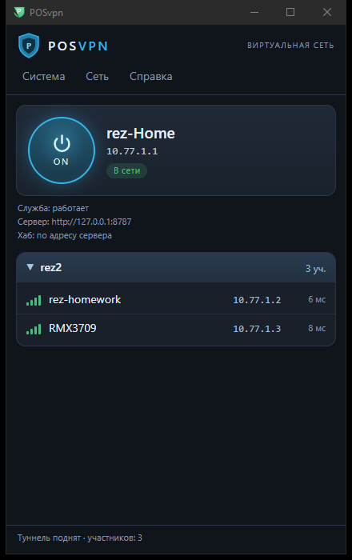
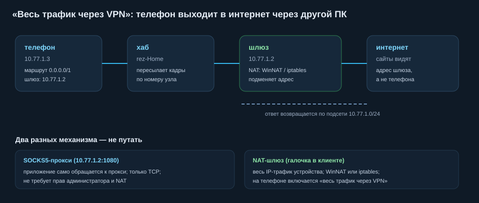

# POSvpn Клиент

Окно Windows, которое собирает компьютеры в одну сеть `10.77.0.0/16`: вход по имени
сети и паролю, без аккаунта и без настройки роутера.

<p></p>

*Главное окно: свой узел с адресом, участники сети и задержка до каждого.*

## Что умеет

| Возможность | Как это выглядит |
|---|---|
| **Туннель L3** | Виртуальный адаптер Wintun, MTU 1100, шифрование X25519 + ChaCha20-Poly1305. Кадры идут через QUIC-хаб, который пересылает их по номеру узла и не читает содержимое. |
| **Адрес в сети** | Координатор выдаёт адрес `10.77.<N>.<M>` и числовой индекс: у каждой сети своя подсеть `/24` внутри `10.77.0.0/16`. |
| **Список узлов** | Имя, адрес, роль, «в сети / офлайн» и задержка в миллисекундах: ping идёт кадрами через туннель раз в 3 секунды. |
| **Служба Windows** | Служба `POSvpn` держит адаптер и туннель без окна, стартует вместе с системой и сама переподключается. Окну права администратора не нужны. |
| **Трей** | Крестик не закрывает программу, а сворачивает окно. Меню: «Открыть», «Подключиться / Отключиться», «Настройки», «Выход». |
| **Прокси SOCKS5** | Узел с интернетом отдаёт его участникам: галочка, порт `1080`, по желанию логин и пароль. Только TCP и только из подсети сети. |
| **NAT-шлюз** | «Раздавать интернет всей сети через этот ПК»: на время туннеля создаётся объект WinNAT `POSvpn`, при отключении снимается. |

## Установка и первый запуск

1. Запустите `POSvpn-Setup-0.9.3.exe` из `installer\out`. Установщик просит права
   администратора, кладёт `posvpn-client.exe` и `wintun.dll`, ставит и запускает службу
   `POSvpn`, добавляет правило брандмауэра для ping из `10.77.0.0/16` и предлагает
   автозапуск свёрнутым в трей.
2. Откройте POSvpn из меню «Пуск»: появится окно без консоли, иконка останется в трее.
3. «Сеть → Создать сеть…»: адрес координатора, имя сети, пароль не короче 8 символов,
   имя этого компьютера. Первый узел создаёт сеть.
4. На остальных компьютерах — «Присоединиться к сети…» с теми же именем и паролем.
5. Нажмите ON/OFF: в окне появится адрес вида `10.77.1.2`, а в списке — остальные узлы
   с задержкой. Проверка — `ping 10.77.1.2` с любого участника.

По умолчанию адрес координатора — `http://127.0.0.1:8787`, то есть сервер на этом же ПК.
Для сервера на VPS или другом компьютере впишите его адрес в диалоге входа или в
«Настройки → Подключение». Хаб — тот же хост, порт `8788`; для HTTPS включите галочку
и укажите отпечаток сертификата: без отпечатка соединение не проверяется, это годится только для отладки.

## Что где в окне

- **Карточка узла** — кнопка ON/OFF, имя компьютера, адрес и состояние: «В сети»,
  «Не подключено», «Не настроено», «Подключение…».
- **Строки под карточкой** — режим (служба или локальный), «Сервер», «Хаб», а при
  включении — «Прокси» и «Шлюз» с адресом и пометкой, поднялись ли они.
- **Список участников** — все узлы сети; задержка обновляется на ходу, «офлайн» значит,
  что узел не отвечает.
- **«Система»** — «Настройки…» и «Выход».
- **«Сеть»** — «Создать сеть…» (Ins), «Присоединиться к сети…» (+), «Отключиться»,
  «Выйти из сети…» (с подтверждением).
- **«Справка → О программе»** — версия и номер сборки, число узлов и режим работы,
  путь к журналу.
- **Внизу** — строка состояния и текст ошибки, если что-то не так.

В настройках пять блоков: «Этот компьютер» (имя, ID, адрес, режим), «Служба» (состояние
и кнопки установки, запуска, остановки, удаления — нужны права администратора),
«Подключение» (сервер, хаб, HTTPS, отпечаток), «Прокси» и «Шлюз в интернет (NAT)».

## Команды

| Команда | Что делает |
|---|---|
| `posvpn-client` | без аргументов открывает окно (без службы — через UAC) |
| `create -network <имя> -password <пароль> [-node <имя>] [-server <url>]` | создаёт сеть; узел становится её первым участником |
| `join -network <имя> -password <пароль> [-node <имя>] [-server <url>]` | входит в существующую сеть по имени и паролю |
| `status` | печатает карту сети: адреса, индексы, роли, кто онлайн |
| `up [-hub <адрес>] [-pin <отпечаток>] [-mtu <n>] [-adapter <имя>]` | поднимает туннель в текущей консоли, Ctrl+C — остановить |
| `down [-adapter <имя>]` | снимает адреса и маршруты с адаптера |
| `service install\|uninstall\|start\|stop\|status\|console\|run` | служба: `status` печатает JSON состояния, `console` — та же служба без регистрации в диспетчере |
| `gui [-connect] [-minimized]` | окно; `-connect` сразу подключается, `-minimized` стартует в трее |
| `wizard` | консольное меню: создать сеть, войти, подключиться, отключиться, участники |
| `version` или `-version` | печатает версию и номер сборки |

`peers` — синоним `status`. Пароль сети — не короче 8 символов. `up` требует прав
администратора и `wintun.dll` рядом с exe.

## Прокси и NAT: два разных механизма

<p></p>

**SOCKS5-прокси — для отдельных приложений.**

1. На узле с интернетом: «Настройки → Прокси» → «Выход в интернет через этот узел»,
   порт `1080`, при необходимости логин и пароль → «Сохранить».
2. Подключитесь: прокси живёт ровно столько же, сколько туннель. В окне появится
   `Прокси: 10.77.1.1:1080`, адрес копируется кнопкой.
3. На других узлах впишите этот адрес в приложение как SOCKS5 (`socks5h`, чтобы имена
   разрешал шлюз). Маршруты не меняются: через прокси идёт только то, что вы направили.

Прокси принимает только TCP (`CONNECT`): игры, звонки и UDP через него не пойдут.

**NAT-шлюз — всему устройству.**

1. На узле с интернетом: «Настройки → Шлюз в интернет (NAT)» → «Раздавать интернет всей
   сети через этот ПК» → «Сохранить».
2. Подключитесь: клиент создаст объект WinNAT `POSvpn` на подсеть сети и включит
   пересылку, а при отключении снимет объект.
3. Устройство, которому нужен весь трафик, направьте на адрес этого узла: в Android-клиенте
   это режим «весь трафик через VPN».

Нужны Windows Pro/Enterprise (WinNAT) и права администратора. На Windows Home WinNAT нет —
там остаётся SOCKS5. Подробности — в [09-прокси-инструкция.md](../docs/09-прокси-инструкция.md).

## Служба и права

Установщик сам выполняет `posvpn-client.exe service install`: создаёт службу `POSvpn`
(LocalSystem, автозапуск) и запускает её.

| Что | Как устроено |
|---|---|
| Владелец адаптера | служба: окно работает без прав администратора и без UAC |
| Связь окна и службы | именованный канал `\\.\pipe\posvpn`, обмен JSON-строками |
| Настройки | окно переносит их в службу при первом запуске — входить в сеть заново не нужно |
| Обрыв связи | сторож повторяет подключение с нарастающей паузой до минуты |
| Без службы | локальный режим: туннель поднимает само окно, нужны права администратора (UAC) |

Вручную: `service status` покажет состояние службы, `service console` поднимет её без
регистрации — удобно, если клиент запускают из папки `out` без установки.

## Если не работает

| Симптом | Что делать |
|---|---|
| В окне «служба остановлена — запустите её в настройках» | «Настройки → Служба → Запустить» (кнопка активна при правах администратора) или `posvpn-client service start` из консоли от администратора |
| «координатор недоступен (http://…)» | сервер не запущен или адрес неверный: проверьте «Настройки → Подключение → Сервер», порт `8787` и доступность сервера |
| «…нужны права администратора и wintun.dll рядом с exe» | положите `wintun.dll` рядом с `posvpn-client.exe` (`tools\fetch-wintun.ps1`) и запустите от администратора |
| Прокси включён, но с других узлов «connection refused» | порт `1080` занят: в журнале `прокси не запущен: …`; смените порт на шлюзе и на клиентах |
| «Шлюз: … (ошибка: NAT не включён: …)» | нет WinNAT или прав: NAT только на Windows Pro/Enterprise, на Home используйте SOCKS5 |

## Логи, настройки и версия

| Что | Портативная установка (`portable.txt` рядом с exe) | Без маркера |
|---|---|---|
| Настройки | `data\client.json` | `%AppData%\POSvpn\client.json` (окно), `%ProgramData%\POSVpn\client.json` (служба) |
| Журнал окна | `data\logs\client.log` | `%LocalAppData%\POSvpn\logs\client.log` |
| Журнал службы | `data\logs\service.log` | `%ProgramData%\POSVpn\logs\service.log` |

Журнал растёт до 10 МБ, хранятся три предыдущих файла (`.log.1` … `.log.3`). Путь к
текущему журналу показан в «Справка → О программе» — там же видно, работает служба или
локальный режим.

```powershell
posvpn-client -version
# POSvpn Клиент 0.9.3 (сборка 1234)
```

Те же цифры — в «Справка → О программе». В `client.json` лежит приватный ключ узла,
на сервер уходит только публичная половина: файл никому не передавайте.
