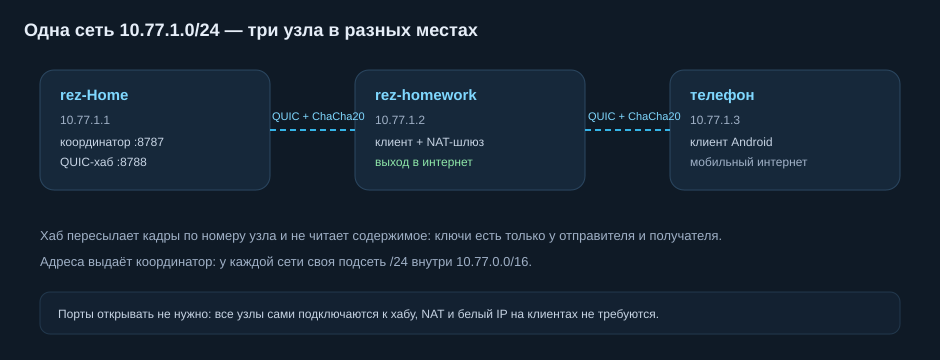

# posvpn-server

Координатор сети POSvpn: реестр сетей и узлов, выдача адресов, карта сети и QUIC-хаб в одном процессе.



*Одна сеть `10.77.1.0/24` — три узла в разных местах. Узлы сами подключаются к координатору (`:8787`) и хабу (`:8788`); проброс портов на клиентах не нужен. Если сервер стоит дома за роутером, пробросьте на него TCP 8787 и UDP 8788 — либо поставьте сервер на VPS с публичным адресом.*

## Что делает

**Координатор.** Хранит сети и узлы, проверяет пароль сети (PBKDF2-HMAC-SHA256, 600 000 итераций), выдаёт узлу адрес из подсети `10.77.<N>.0/24`, числовой индекс и токен, собирает карту сети — снимок состава с адресами, индексами, ролями и внешними адресами (endpoint). Имя сети уникально без учёта регистра, имя узла — внутри сети; последний администратор не может покинуть сеть.

**Хаб.** Слушает по умолчанию `0.0.0.0:8788` по QUIC, принимает только узлы с действующим токеном и пересылает кадры по числовому индексу. `src` всегда подменяется на индекс отправителя, `dst = 0` размножается по всей сети. Содержимое кадров хаб не читает: ключи есть только у отправителя и получателя.

**Хранилище.** Один JSON-файл `server.json`: сети, узлы, счётчик подсетей и версия карты. Запись атомарная — временный файл и `rename`, поэтому падение процесса не оставляет недописанный JSON. Токены хранятся только как SHA-256, пароли — только как хеш.

**Счётчики.** Четыре цифры в окне сервера, сбрасываются при перезапуске:

| Счётчик | Что значит |
|---|---|
| принято | кадры, пришедшие от клиентов |
| переслано | кадры, доставленные конкретному адресату |
| бродкаст | кадры `dst = 0`, разосланные всей сети |
| отброшено | доставить не удалось: неизвестный индекс, кадр больше лимита, битый заголовок |

«Отброшено» — нормальная часть работы: при обрывах связи и переподключениях счётчик растёт.

Лимиты MVP: до 25 узлов в сети, до 254 сетей, пароль от 8 символов, имя до 40.

## Быстрый старт

1. **Собрать.** Из корня репозитория: `.\build.ps1` → `out\posvpn-server.exe` и `out\posvpn-client.exe`. Установщик `installer\out\POSvpn-Setup-<версия>.exe` собирается `.\release.ps1`.
2. **Запустить.** `.\out\posvpn-server.exe` — на Windows откроется окно. Без окна: `.\out\posvpn-server.exe -console` (служба, VPS, отладка).
3. **Порты.** `8787` — control-API, `8788` — QUIC-хаб; на VPS оба должны быть доступны клиентам.
4. **TLS.** `-tls` включает HTTPS на постоянном сертификате хаба: отпечаток печатается в журнал и показывается в окне, клиенту он нужен как `-pin`. Свой сертификат для API — `-tls-cert` и `-tls-key` (парой).
5. **Первый запуск.** Видны адреса, отпечаток, сети и узлы, счётчики и пути к состоянию и журналу. «Настройки» меняют адреса без перезапуска программы; крестик сворачивает окно в трей.
6. **Создать сеть.** `.\out\posvpn-client.exe create -server https://<сервер>:8787 -pin <отпечаток> -network office -password secret123 -node PC-1`. Без TLS — `http://<сервер>:8787` и без `-pin`; на втором компьютере `join` вместо `create`.

## Флаги

Значения `-listen`, `-hub` и `-tls` по умолчанию берутся из `server-ui.json`; явно переданный флаг сильнее файла.

| Флаг | По умолчанию | Что делает |
|---|---|---|
| `-listen` | `0.0.0.0:8787` | адрес и порт control-API |
| `-hub` | `0.0.0.0:8788` | адрес QUIC-хаба; пусто — не запускать хаб |
| `-store` | `server.json` | файл состояния координатора (портативная установка — `data\server.json`) |
| `-tls-cert` | пусто | сертификат TLS для HTTPS API; задаётся вместе с ключом |
| `-tls-key` | пусто | ключ TLS |
| `-gui` | вкл. на Windows | открыть окно сервера |
| `-console` | выкл. | работать без окна: служба, VPS, отладка; сильнее `-gui` |
| `-minimized` | выкл. | запустить свёрнутым в трей |
| `-tls` | из `server-ui.json`, обычно выкл. | HTTPS для control-API на сертификате хаба; клиентам нужен `-pin` |
| `-version` | выкл. | показать версию и сборку, затем выйти |

## HTTP API

База: `http://<сервер>:8787/api/v1`, с `-tls` или парой `-tls-cert`/`-tls-key` — `https://`. Тело и ответы — JSON; защищённые маршруты требуют заголовок `Authorization` со схемой `Bearer` и токеном узла.

| Метод | Путь | Доступ | Смысл |
|---|---|---|---|
| POST | `/api/v1/networks` | без токена | создать сеть и первый узел-администратор; 201 `{node_id, token, netmap}` |
| POST | `/api/v1/networks/join` | без токена | войти по имени и паролю; 200 `{node_id, token, netmap}` |
| GET | `/api/v1/netmap` | Bearer | карта сети для своего узла |
| POST | `/api/v1/heartbeat` | Bearer | сообщить внешний `endpoint`, получить `netmap_version` |
| POST | `/api/v1/leave` | Bearer | выйти из сети; 204; последний администратор получает 409 |
| GET | `/api/v1/health` | без токена | `{"status":"ok"}` |

Тела создания и входа: `{name, password, node_name, public_key}`. Ошибки: 400 — некорректный запрос, 401 — пароль или токен, 403 — сеть закрыта или узел заблокирован, 404 — нет сети или узла, 409 — конфликт имени или лимит участников, 507 — исчерпан пул подсетей.

## Данные, журналы, версия

| Что | Где |
|---|---|
| Состояние | `server.json` в рабочем каталоге; при запуске из `out` без файла берётся из корня проекта. Портативная установка — `data\server.json` |
| Настройки окна | `%LocalAppData%\POSvpn\server-ui.json` (портативная — `data\server-ui.json`) |
| Сертификат хаба | `hub-cert.pem` и `hub-key.pem` рядом с `server.json`; если каталог недоступен на запись — `%ProgramData%\POSvpn` |
| Журнал | `%LocalAppData%\POSvpn\logs\server.log`, ротация 10 МБ, три предыдущих (портативная — `data\logs\server.log`) |

Версия и номер сборки:

```powershell
.\out\posvpn-server.exe -version
# POSvpn Server 0.9.3 (сборка N)
```

`N` — номер сборки: `build.ps1` считает коммиты (`git rev-list --count HEAD`). Без ldflags остаётся `dev (сборка 0)`.

Если `server.json` потерян, сервер стартует с пустым состоянием: прежние токены получат `401`, а в журнале появится «состояние пустое: сетей нет».

## Служба, VPS, systemd

- **Окно Windows.** Сервер открывает окно по умолчанию; `-console` — без окна, `-minimized` — сразу в трей. Крестик сворачивает окно, «Выход» останавливает сервер.
- **Служба Windows.** Установщик ставит службу `POSvpn` (LocalSystem, автозапуск): она владеет адаптером, маршрутами и туннелем клиента, поэтому окно клиента работает без UAC. Своей службы у сервера в docs не описано — его запускают окном или с `-console`.
- **VPS.** Сервер запускают с `-console`; `server.json` и сертификат кладут в каталог, доступный на запись, а порты `8787` и `8788` оставляют открытыми для клиентов.
- **systemd.** Готового unit-файла в `docs/` нет; сервер запускают вручную или своим супервизором с `-console`.

## Если не работает

| Симптом | Что делать |
|---|---|
| Все клиенты получают `401` после переноса сервера | `server.json` не найден, состояние пустое: скопировать файл от прошлой установки или создать сеть заново |
| Удалённые клиенты не подключаются | проверьте `-listen`: с `127.0.0.1` сервер доступен только этому компьютеру |
| Клиент отвергает HTTPS | самоподписанный сертификат проверяется по отпечатку: передайте `-pin` или впишите его в настройках клиента |
| Прокси отвечает, но сайты не открываются | у шлюза нет интернета или не работает DNS — проверить на шлюзе `curl.exe https://example.com` |
| При включении прокси «порт занят» | `1080` занят другой программой — сменить порт на шлюзе и на клиентах |

## Документы

- [03-архитектура.md](../docs/03-архитектура.md) — компоненты, API, формат кадра, безопасность.
- [06-ТЗ.md](../docs/06-ТЗ.md) — требования, этапы и приёмка.
- [10-эксплуатация.md](../docs/10-эксплуатация.md) — окно, трей, HTTPS, журналы, служба.
- [09-прокси-инструкция.md](../docs/09-прокси-инструкция.md) — интернет через узел и разбор проблем.

Тесты сервера: `cd posvpn-server; go test ./...`.
